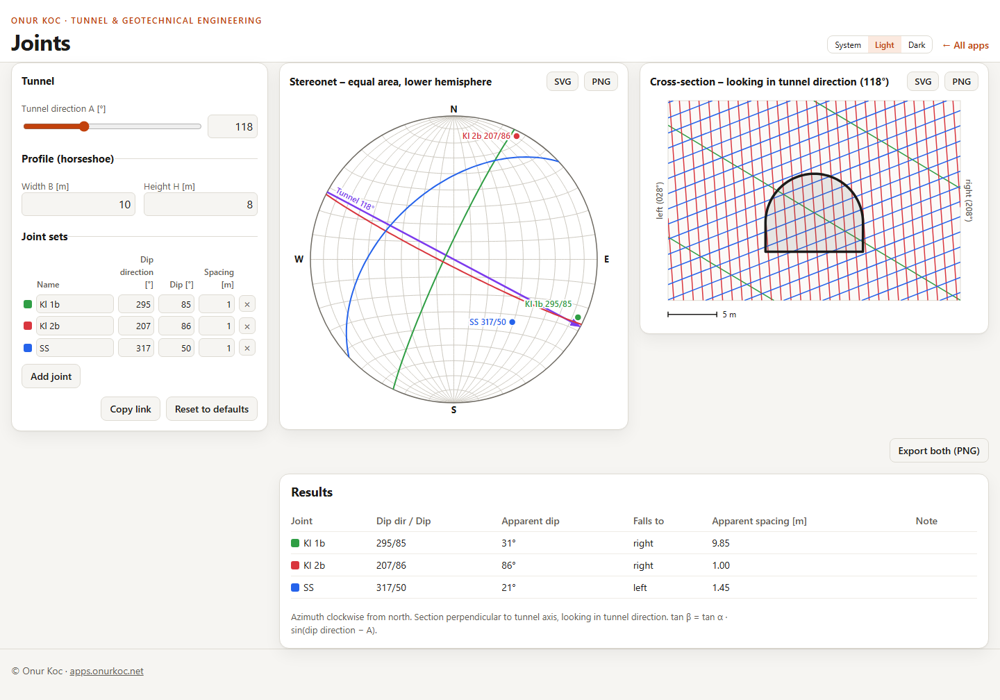

# Joints

Joint sets in an equal-area stereonet and as traces in a tunnel cross-section.

You enter the tunnel direction and up to five joint sets (name, dip direction, dip, spacing).
The app shows

- a Schmidt equal-area net (lower hemisphere) with the great circle and the pole of every joint set and the tunnel direction as a line, and
- the tunnel cross-section (horseshoe profile) perpendicular to the tunnel axis with the traces of the joint sets,

together with a table of the apparent dip and the apparent spacing of every set in the section.
Everything is calculated in the browser; nothing is uploaded.
The inputs can be shared as a link, and both graphics can be exported as SVG or PNG.



## Conventions

- All angles in degrees. Azimuth clockwise from north, 0…360.
- Coordinates: x = east, y = north, z = up.
- Joint set: dip direction (0…360) and dip (0…90). Spacing in m, measured perpendicular to the joint plane.
  Labels read «name dip direction/dip», for example `Kl 1b 295/85` or `007/05` (three digits / two digits).
- Stereonet: equal-area (Schmidt), lower hemisphere, north up.
  A line with trend *t* and plunge *p* plots at r = R·√2·sin((90° − p)/2), x = r·sin t, y = r·cos t.
  The pole of a joint set has trend = dip direction + 180° and plunge = 90° − dip.
- Tunnel: horizontal, tunnel direction A = direction of advance.
- Cross-section: perpendicular to the tunnel axis, looking in tunnel direction.
  Image axis to the right = azimuth A + 90°, image axis up = z.
- Apparent dip in the section: tan β = tan α · sin(dip direction − A).
  β > 0 means the trace falls to the right. The table gives the magnitude and the side (right / left / horizontal / vertical).
- Apparent spacing in the section: s' = s / sin θ, with θ the angle between the joint normal and the tunnel axis.
  If sin θ < 0.02 the joint is practically parallel to the section: no traces are drawn and the table says so.
- Horseshoe profile: width B, height H, flat invert at z = 0, vertical walls up to H − B/2, semicircular crown of radius B/2. Requires H ≥ B/2. Default B = 10 m, H = 8 m.
- Trace set: parallel lines at the distance s', one of them through the middle of the profile (0, H/2).
- Export: always the light colour scheme on a white background, independent of the theme of the page.

## Run locally

The page uses ES modules, so it needs a web server; opening `index.html` from the file system does not work.

```sh
npm start
```

serves the folder `app/` at <http://localhost:8000/> (`node serve.mjs --port 8080` for another port).
Node 21 or newer is needed; there is nothing to install.

## Tests

```sh
npm test
```

runs the unit tests (`node --test`, folder `tests/`): the calculation core in `app/core/`, the label placement, the link, and the export.

A check in a real browser (a headless Chromium-based browser, path via `--edge <path>`) is separate:

```sh
node tests/browser/check.mjs
```

It starts the local server, goes through the app and writes screenshots and example exports to `docs/screenshots/`.

## Layout

| Path | Content |
| --- | --- |
| `app/core/` | Calculation core: pure functions, no DOM access |
| `app/plots/` | Stereonet and cross-section as SVG text, label placement |
| `app/ui/` | Inputs, results table, theme switch, tooltip, downloads |
| `app/export.js`, `app/link.js` | Export images, inputs in the URL after `#` |
| `tests/` | Unit tests and the browser check |

No build step, no framework, no runtime dependencies.
